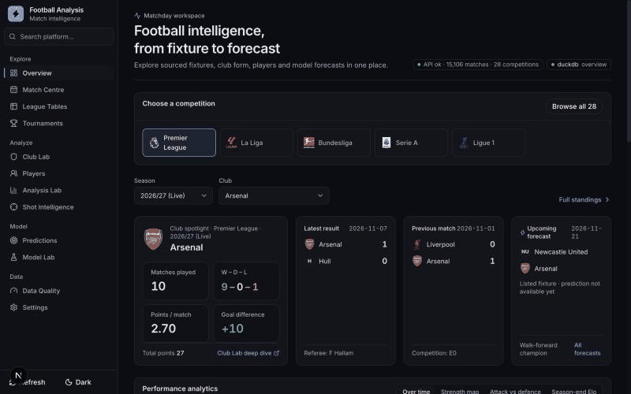

# football_analysis

A football data engineering and data science project: 20 seasons of European league data
are landed, modelled in a tested dbt warehouse, orchestrated with Dagster, used to train and
compare match-outcome models tracked in MLflow, and served through FastAPI to a Next.js app.
No paid API or key is required.

<p align="center"></p>

## Architecture

[](docs/architecture.svg)

## Quick start

First run (works in bash, zsh and fish; commands read `.env` themselves):

```bash
uv sync --extra dev --extra de --extra ml
uv run football-sync --bootstrap        # all sources + 2005+ history once (~15 min), then warehouse, models, publish
uv run football-api                      # http://127.0.0.1:8000 (reads Supabase, SQLite fallback)
npm --prefix frontend run dev -- --port 3001
```

Day to day, one command does everything (extract → dbt build → champion refit → publish):

| Command                          | What it runs                                                            | Time    |
| -------------------------------- | ----------------------------------------------------------------------- | ------- |
| `uv run football-sync --quick` | current results + fixtures, warehouse, forecasts, publish               | ~2 min  |
| `uv run football-sync`         | all sources (standings, cups, players, media, event details) + the same | ~10 min |
| `uv run football-train-models` | full 9-model walk-forward leaderboard (auto-runs weekly anyway)         | ~10 min |

Refreshes run when you start them. For an automatic schedule, use the containers below: their
`scheduler` service runs a quick refresh every 6 hours and a full one once a day.

Failure alerts: set `NTFY_TOPIC` in `.env` and subscribe to that topic in the [ntfy](https://ntfy.sh) app;
a failed or crashed refresh, or Supabase above 85% of its quota, sends a notification.

Run everything in containers instead (API, web, scheduler; data stays in `./data`):

```bash
docker compose up -d --build       # or: podman compose up -d --build
```

Both images run as an unprivileged user (UID 1000, so `./data` must be writable by it) and declare health checks; `web` starts once `api` is healthy. Podman ignores `HEALTHCHECK` in its default OCI format: build with `BUILDAH_FORMAT=docker`. To serve beyond localhost set `PUBLIC_API_URL` and `FOOTBALL_CORS_ORIGINS` in `.env`.

Other tools: `DAGSTER_HOME=$PWD/.dagster uv run dagster dev -m football_analysis.orchestration`
(asset lineage, runs, schedules at http://localhost:3000) and
`uv run mlflow ui --backend-store-uri sqlite:///mlflow.db` (experiments). DuckDB allows one writer;
the API reads Supabase, so refreshes never conflict with it.

## Model results

Walk-forward evaluation: each of the last four completed seasons is predicted by models trained
only on earlier seasons (calibrated on the season before), scored on 13,061 top-flight matches.

| Model                                 | RPS ↓           | Log loss ↓     | Accuracy        | ECE ↓          |
| ------------------------------------- | ---------------- | --------------- | --------------- | --------------- |
| Bookmaker closing line (benchmark)    | 0.1905           | 0.954           | 54.9%           | 0.011           |
| Model + opening odds                  | 0.1911           | 0.956           | 54.4%           | 0.004           |
| **Stacked (champion, no odds)** | **0.1928** | **0.962** | **54.0%** | **0.003** |
| Ensemble                              | 0.1928           | 0.962           | 53.9%           | 0.005           |
| Logistic regression                   | 0.1929           | 0.962           | 54.0%           | 0.005           |
| LightGBM                              | 0.1930           | 0.963           | 53.9%           | 0.004           |
| Poisson + Dixon-Coles                 | 0.1930           | 0.963           | 54.0%           | 0.006           |
| Elo only                              | 0.1971           | 0.976           | 53.0%           | 0.006           |
| Base-rate guess                       | 0.2304           | 1.074           | 43.8%           | 0.009           |

The champion recovers 94% of the closing line's skill over a base-rate guess and meets every target
(log loss, RPS, calibration and 53.5% accuracy). The largest gain came from a market-implied team
strength learned from *past* opening prices only, so no forecast uses its own match's odds.
Forecasts at ≥75% confidence (11% of matches) were right 80.8% of the time. See
[docs/MODELLING.md](docs/MODELLING.md).

## Scope

- **Leagues:** every club in ten domestic leagues (Premier League, La Liga, Bundesliga, Serie A, Ligue 1, Eredivisie, Primeira Liga, Belgian Pro League, Turkish Süper Lig, Greek Super League), seasons 2021/22–2025/26 plus the live 2026/27 campaign. Live rows are labelled as partial and never shown as a completed season.
- **Tournaments:** five Champions League seasons (753 matches), the 2025 Club World Cup (64) and the 2018, 2022 and 2026 World Cups (232), with stage, team, scoring and match-result views. Cups and continental tournaments load when their sources publish an edition.
- **App:** one typo-tolerant search and ten pages in four groups: Explore (Overview, Match Centre, League tables, Tournaments), Analyze (Club lab, Players, Analysis lab, Shot lab), Model (Predictions, Model lab) and Data (Data quality, Settings).
- **Forecasts:** the walk-forward champion from Model results, with per-league diagnostics and a forecast journal that keeps the issued probabilities and later fills in the real results.
- **Players:** 458 tracked 2025/26 player records for 12 clubs and 4,633 competition-season rows, from the CC0 Transfermarkt Open Dataset.
- **Not claimed:** current 2026/27 squad accuracy, xG or possession. Kickoff times are shown as unverified source times.

Every source, its validation guard and its known gaps (for example Belgium's undated rounds and Turkey's missing open calendar) are in [docs/DATA_SOURCES.md](docs/DATA_SOURCES.md).

## Structure

- `src/football_analysis/adapters.py`: remote public CSV and offline replay adapters, common interface, validation, retries and cache.
- `src/football_analysis/schema.sql`: SQL match table, ingestion audit and team-level analytical views.
- `src/football_analysis/ingest.py`: CLI, transactional partition replacement, checksum and failure audit.
- `src/football_analysis/pipeline.py` and `sync_state.py`: one incremental/bootstrap command and persisted freshness gates for rate-limited sources.
- `src/football_analysis/teams.py`: canonical provider-independent club labels and reconciliation keys.
- `src/football_analysis/recent.py`: current-season result and fixture synchronization for ten leagues.
- `src/football_analysis/fixtures.py`: guarded weekly fixture import and current-club reconciliation.
- `src/football_analysis/open_fixtures.py`: validated full-season CC0 schedules (football.json and Football.TXT) for eight leagues, Belgium pending dates.
- `src/football_analysis/api_football.py`: optional daily squad cache for the featured clubs from API-Football (no-op without `API_FOOTBALL_KEY`).
- `src/football_analysis/open_players.py`: featured-player aggregation plus normalized historical match context, event timelines, lineup roles and cup results from published CC0 CSVs.
- `src/football_analysis/players.py`: capped TheSportsDB profile and artwork fallback synchronization.
- `src/football_analysis/media.py`: cached club and competition artwork synchronization.
- `src/football_analysis/tournaments.py`: no-key CC0 Champions League, Club World Cup and World Cup adapters, cache and transactional synchronization.
- `src/football_analysis/analysis_system.py`: reusable filtering, ranking, form and correlation engine served through FastAPI.
- `src/football_analysis/event_details.py`: explicitly capped current-event enrichment from free TheSportsDB endpoints; Match Centre prefers the normalized historical Transfermarkt context, timeline and lineup tables when available.
- `src/football_analysis/history.py`: lands 2005+ Football-Data CSVs (15 leagues, odds) for the warehouse.
- `warehouse/`: dbt project — staging views over every raw table, marts and ML models plus data tests (`uv run football-build-warehouse`; `dbt docs generate` for lineage). The API reads the `tag:serving` marts (each with a documented grain in `models/marts/_serving.yml`): `mart_dashboard_*` (validated five-season window), `fct_tournament_match/goal`, `fct_match_context`, `fct_match_timeline_event`, `fct_match_lineup`, `dim_player`, `fct_player_competition_season` and `fct_transfer`.
- `src/football_analysis/warehouse.py`: `football-build-warehouse` and the pipeline-status recorder.
- `src/football_analysis/ml/`: feature engine, candidate models, walk-forward evaluation, MLflow training and publication to the app tables (see `docs/MODELLING.md`).
- `src/football_analysis/orchestration/`: Dagster assets, jobs and schedules.
- `src/football_analysis/publish.py`: incremental PostgreSQL publish (only changed tables, one-transaction swap, size alert) and SQLite fallback.
- `src/football_analysis/pg.py`: shared PostgreSQL helpers (TLS for Supabase, private schema names, row digests).
- `Dockerfile`, `frontend/Dockerfile`, `compose.yaml`: container deployment, including the scheduled refreshes.
- `frontend/`: responsive Next.js and HeroUI application using the versioned FastAPI contracts.
- `docs/`: `MODELLING.md`, `DATA_SOURCES.md` (scope, sources and their guards), `VALIDATION.md` (current checks), `openapi_v1.json` (generated API contract) and `architecture.svg`/`.png` (full pipeline diagram).
- `tests/`: data-quality, idempotency and dashboard tests.

Data lives in `data/`; override with `FOOTBALL_DATA_DIR`. Raw archives and the database are excluded from version control. The lockfile pins the tested environment. No automated downloads run on page views.

The API's `POST /api/v1/refresh` only accepts loopback callers; set `FOOTBALL_ADMIN_TOKEN` and send it as `X-Admin-Token` to trigger it from elsewhere (for example inside containers). With the PostgreSQL backend the cache generation is the published `snapshot_manifest` digest (re-checked every minute), so a publish from another process invalidates ETags; a dropped connection is retried once, then the API serves the SQLite fallback and retries PostgreSQL every five minutes.

Optional API response caching: install the Redis extra (`uv sync --extra redis`) and set `REDIS_URL` to a Redis URL. Only catalog and overview GET JSON responses use Redis, with 300-second and 60-second TTLs respectively. Each reopened DuckDB snapshot gets a new cache generation after refresh; Redis errors fall back to DuckDB. Without `REDIS_URL`, the API uses DuckDB as before.

Serving: `football-publish` publishes only what the API reads (the serving marts plus live app tables listed in `publish.py`); raw tables behind the marts stay in DuckDB, and a table that stops being served is dropped from PostgreSQL before new ones are copied. It compares each table's row digest with `snapshot_manifest` in the
private PostgreSQL schema (`FOOTBALL_POSTGRES_SCHEMA`), copies only changed tables to `<table>__next`
and swaps them in one transaction, so the Supabase free tier (500 MB) never needs a second copy.
It then rebuilds `data/football.sqlite3` from DuckDB. With `FOOTBALL_API_READ_BACKEND=postgres`
the API reads PostgreSQL and falls back to that SQLite file when the database is unreachable.
DuckDB is the only writer and computes everything; PostgreSQL only serves.

## Verification

```bash
uv run pytest -q
uvx ruff@0.14.0 check src tests
./scripts/ci_warehouse.sh            # dbt models + data tests on fixture data
cd frontend
npm run lint
npm run build
npx playwright install chromium
npm run test:e2e
```

See `docs/VALIDATION.md` for current validation results and coverage. Free access does not imply an unrestricted redistribution licence; retain attribution and review the source terms before distributing raw files or commercial deployment.
