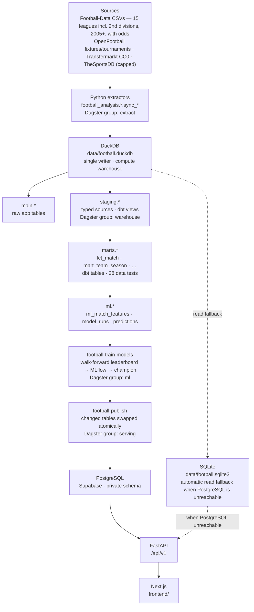

# football_analysis

A football data engineering and data science project: 20 seasons of European league data
are landed, modelled in a tested dbt warehouse, orchestrated with Dagster, used to train and
compare match-outcome models tracked in MLflow, and served through FastAPI to a Next.js app.
No paid API or key is required.

## Architecture



## Quick start

```bash
uv sync --extra dev --extra de --extra ml
uv run football-fetch-history                 # land 2005+ CSVs (once; ~6 min, courteous pacing)
uv run football-build-warehouse                # dbt build: models + 28 data tests
uv run football-train-models                  # leaderboard + champion + forecasts
set -a; . ./.env; set +a; uv run football-publish   # PostgreSQL + SQLite fallback
FOOTBALL_API_READ_BACKEND=postgres uv run football-api
npm --prefix frontend run dev -- --port 3001
```

Orchestrated instead of by hand (UI at http://localhost:3000, schedules mirror the old cadence):

```bash
cp dagster.yaml .dagster/ && DAGSTER_HOME=$PWD/.dagster uv run dagster dev -m football_analysis.orchestration
```

Experiment tracking: `uv run mlflow ui --backend-store-uri sqlite:///mlflow.db`.
`uv run football-sync` and the Settings refresh still work; step 4 now rebuilds the warehouse,
retrains and publishes. DuckDB allows one writer: stop other processes holding the file first.

## Model results

Walk-forward evaluation: each of the last four completed seasons is predicted by models trained
only on earlier seasons (calibrated on the season before), scored on 13,061 top-flight matches.

| Model | RPS ↓ | Log loss ↓ | Accuracy | ECE ↓ |
|---|---|---|---|---|
| Bookmaker closing line (benchmark) | 0.1905 | 0.954 | 54.9% | 0.011 |
| Model + opening odds | 0.1911 | 0.956 | 54.4% | 0.004 |
| **Ensemble (champion, no odds)** | **0.1946** | **0.967** | **53.4%** | **0.005** |
| Logistic regression | 0.1947 | 0.968 | 53.4% | 0.005 |
| LightGBM | 0.1949 | 0.969 | 53.4% | 0.003 |
| Poisson + Dixon-Coles | 0.1951 | 0.969 | 53.3% | 0.004 |
| Elo only | 0.1975 | 0.977 | 53.0% | 0.006 |
| Base-rate guess | 0.2304 | 1.074 | 43.8% | 0.009 |

The champion recovers 89% of the closing line's skill over a base-rate guess and meets the
log-loss, RPS and calibration targets; accuracy (53.4%) is 0.1 points under its 53.5% target, well
inside the ±0.4-point standard error on 13k matches.
Forecasts at ≥75% confidence (9% of matches) were right 82.3% of the time. See
[docs/MODELLING.md](docs/MODELLING.md) and [docs/DATA_MODEL.md](docs/DATA_MODEL.md).

## Scope

All clubs currently present across the Premier League, La Liga, Bundesliga, Serie A, Ligue 1, Eredivisie, Primeira Liga, Belgian Pro League, Turkish Süper Lig and Greek Super League are selectable. The grouped tournament workflow also covers UEFA club competitions, major English/Spanish/German/Italian/Dutch cups and super cups, the Euros, Copa América, AFCON, Asian Cup, FIFA Club World Cup and FIFA World Cup whenever the configured sources publish an edition.

The analytical range is 2021/22–2025/26 plus the live 2026/27 campaign. The July rollover selects five candidate completed seasons; each completed CSV must independently pass full double-round-robin coverage checks. Live rows are clearly labelled as partial and never presented as a completed season.

Dashboard: one typo-tolerant platform search, three domestic analysis modes and ten focused pages grouped as Explore (Overview, Match Centre, League tables, Tournaments), Analyze (Club lab, Players, Analysis lab, Shot lab), Model (Predictions, Model lab) and Data (Data quality, Settings). Match Centre search runs across the filtered data before pagination, and its detail URLs survive reloads. Every listed match opens a factual story with stored statistics, real manager/formation context when published, named goals/cards/substitutions/missed penalties and verified lineup positions and portraits on a responsive pitch. Club head-to-head reads the unified league-and-cup store. The Analysis lab slices domestic and tournament data by competition, edition, team and venue; ranks teams by seven metrics; builds a correlation matrix; analyzes first-half scoring, corners, fouls, cards and referee trends; and exports both the rankings and exact match slice.

The predictive section serves the walk-forward champion (see Model results above). The Predictions page shows coverage, per-league and per-outcome diagnostics, season-by-season walk-forward results, and a forecast journal that preserves issued probabilities while later filling in actual results; the Model Lab compares every candidate against the base rate and the closing betting line. Long-range forecasts use current known form and cannot anticipate intervening events. Conservative current-points projections provide title shares for all ten domestic leagues.

OpenFootball's CC0 JSON supplies guarded full-season schedules for seven 2026/27 leagues (E0, SP1, D1, I1, F1, N1, P1). Each 12-hour cached partition must pass complete double-round-robin, date and club-reconciliation checks before replacing the previous snapshot. Belgium, Turkey and Greece have no verified current OpenFootball calendar. The optional Football-Data.co.uk weekly CSV remains a six-hour cached nearby-fixture fallback; its checked file had no future rows on 23 September 2026. Both sources' kickoff times are displayed as unverified source times, not converted to a presumed timezone. Data Quality shows future-row coverage by source.

The tournament adapter loads five completed Champions League seasons (753 matches), the 2025 Club World Cup (64 matches), and the 2018, 2022 and 2026 World Cups (232 matches) from OpenFootball's CC0 repositories without an API key. All three competition families have stage, team, performance, scoring and match-result views. The World Cup view also uses 649 published goal events for scorer, penalty and own-goal analysis.

The 2026/27 campaign is integrated into every match-driven page and adds the Eredivisie, Primeira Liga, Belgian Pro League, Turkish Süper Lig and Greek Super League to the core five leagues. Overview shows the selected club's two nearest completed matches and next listed fixture when available; League tables reconstruct live partial standings; Club lab, Shot lab and Match explorer use the same current rows. The player explorer contains 458 tracked 2025/26 player records for the 12 clubs and 4,633 competition-season rows covering appearances, goals, assists, minutes and cards in 41 competitions. These come from the CC0 Transfermarkt Open Dataset, whose update pause and cutoff are visible in the interface. TheSportsDB remains an image and nearby-event fallback. The Catppuccin Mocha interface respects reduced-motion preferences. The app does not claim current 2026/27 squad accuracy, xG or possession.

## Structure

- `src/football_analysis/adapters.py`: remote public CSV and offline replay adapters, common interface, validation, retries and cache.
- `src/football_analysis/schema.sql`: SQL match table, ingestion audit and team-level analytical views.
- `src/football_analysis/ingest.py`: CLI, transactional partition replacement, checksum and failure audit.
- `src/football_analysis/pipeline.py` and `sync_state.py`: one incremental/bootstrap command and persisted freshness gates for rate-limited sources.
- `src/football_analysis/teams.py`: canonical provider-independent club labels and reconciliation keys.
- `src/football_analysis/recent.py`: current-season result and fixture synchronization for ten leagues.
- `src/football_analysis/fixtures.py`: guarded weekly fixture import and current-club reconciliation.
- `src/football_analysis/open_fixtures.py`: validated full-season CC0 schedules for seven leagues.
- `src/football_analysis/open_players.py`: featured-player aggregation plus normalized historical match context, event timelines, lineup roles and cup results from published CC0 CSVs.
- `src/football_analysis/players.py`: capped TheSportsDB profile and artwork fallback synchronization.
- `src/football_analysis/media.py`: cached club and competition artwork synchronization.
- `src/football_analysis/tournaments.py`: no-key CC0 Champions League, Club World Cup and World Cup adapters, cache and transactional synchronization.
- `src/football_analysis/analysis_system.py`: reusable filtering, ranking, form and correlation engine served through FastAPI.
- `src/football_analysis/event_details.py`: explicitly capped current-event enrichment from free TheSportsDB endpoints; Match Centre prefers the normalized historical Transfermarkt context, timeline and lineup tables when available.
- `src/football_analysis/history.py`: lands 2005+ Football-Data CSVs (15 leagues, odds) for the warehouse.
- `warehouse/`: dbt project — staging, marts and ML feature models plus data tests (see `docs/DATA_MODEL.md`).
- `src/football_analysis/warehouse.py`: `football-build-warehouse` and the pipeline-status recorder.
- `src/football_analysis/ml/`: feature engine, candidate models, walk-forward evaluation, MLflow training and publication to the app tables (see `docs/MODELLING.md`).
- `src/football_analysis/orchestration/`: Dagster assets, jobs and schedules.
- `src/football_analysis/publish.py`: incremental PostgreSQL publish and SQLite fallback (see `docs/DATABASE_DECISION.md`).
- `src/football_analysis/predictions.py` and `prediction_features.py`: legacy softmax plus backtest helpers reused by `ml/publish.py`.
- `frontend/`: responsive Next.js and HeroUI application using the versioned FastAPI contracts.
- `docs/`: `DATA_MODEL.md`, `MODELLING.md`, `DATABASE_DECISION.md`, `VALIDATION.md` (current checks), `BACKLOG.md` (open work), source research (`SOURCES.md`, `SOURCE_CAPABILITY_AUDIT.md`, `FUTURE_FIXTURE_SOURCES.md`, `PLAYER_DB_RESEARCH.md`) and `openapi_v1.json` (generated API contract).
- `tests/`: data-quality, idempotency and dashboard tests.

Data lives in `data/`; override with `FOOTBALL_DATA_DIR`. Raw archives and the database are excluded from version control. The lockfile pins the tested environment. No automated downloads run on page views.

Optional API response caching: install the Redis extra (`uv sync --extra redis`) and set `REDIS_URL` to a Redis URL. Only catalog and overview GET JSON responses use Redis, with 300-second and 60-second TTLs respectively. Each reopened DuckDB snapshot gets a new cache generation after refresh; Redis errors fall back to DuckDB. Without `REDIS_URL`, the API uses DuckDB as before.

Serving: `football-publish` compares each table's row digest with `snapshot_manifest` in the
private PostgreSQL schema (`FOOTBALL_POSTGRES_SCHEMA`), copies only changed tables to `<table>__next`
and swaps them in one transaction, so the Supabase free tier (500 MB) never needs a second copy.
It then rebuilds `data/football.sqlite3` from DuckDB. With `FOOTBALL_API_READ_BACKEND=postgres`
the API reads PostgreSQL and falls back to that SQLite file when the database is unreachable.
See [the database decision](docs/DATABASE_DECISION.md).

## Verification

```bash
uv run pytest -q
./scripts/ci_warehouse.sh            # dbt models + data tests on fixture data
cd frontend
npm run lint
npm run build
npx playwright install chromium
npm run test:e2e
```

See `docs/VALIDATION.md` for current validation results and coverage. Free access does not imply an unrestricted redistribution licence; retain attribution and review the source terms before distributing raw files or commercial deployment.
